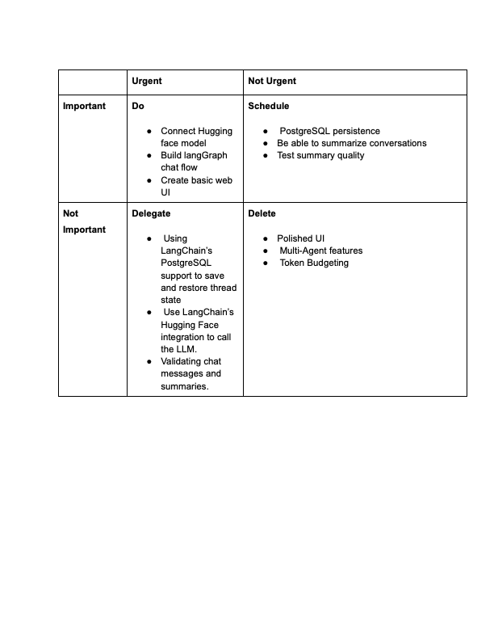
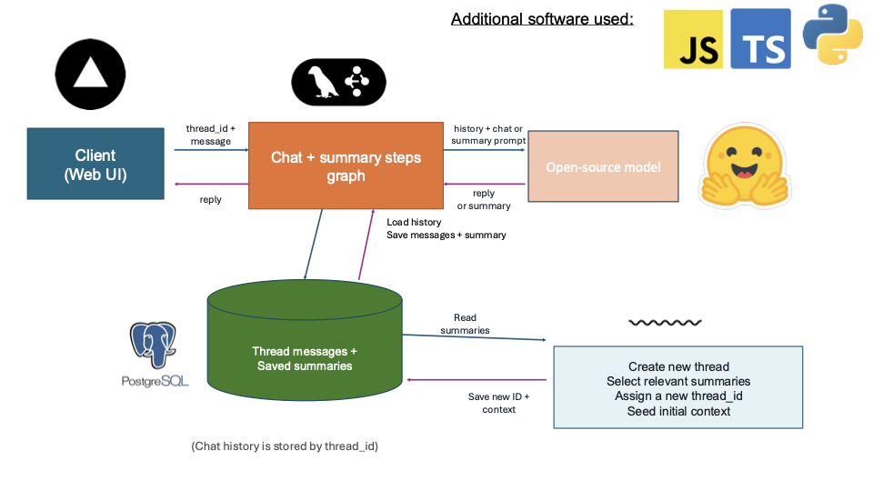

# Context Funnelling Agent Project

## Project Goal:

Be able to funnel context from a pre-existing agent conversation into a new one. Continues on an open source model in order to move on with a related topic, as well as reducing costs (token use from paid models).

## MVP:

- Provide a basic web UI to start or continue a thread, send messages, and read replies.
- Users request a conversation summary and start a new thread with selected summary context. Conversations are summarized through LangGraph's structure, with the use of an open source LLM.
- Persist conversation histories and summaries in PostgreSQL, and keep each thread's messages separate.


## Future plans:

- Select relevant summaries within a configurable token budget.
- Add automatic summarization at a token threshold and evaluate summary quality.
- Improve the web UI's layout, accessibility, and responsive behavior.

## Eisenhower Matrix




## Tech stack

- Python
- LangGraph and LangChain
- Ollama for running an open-weight model locally
- PostgreSQL
- JavaScript/TypeScript for the web UI
- Git and VS Code

## System diagram




## Project structure

```text

context-funnel/
├── docs/
├── src/
│   └── context_funnel/
├── tests/
│   ├── unit/
│   └── integration/
├── web/
│   └── src/
└── migrations/
```
