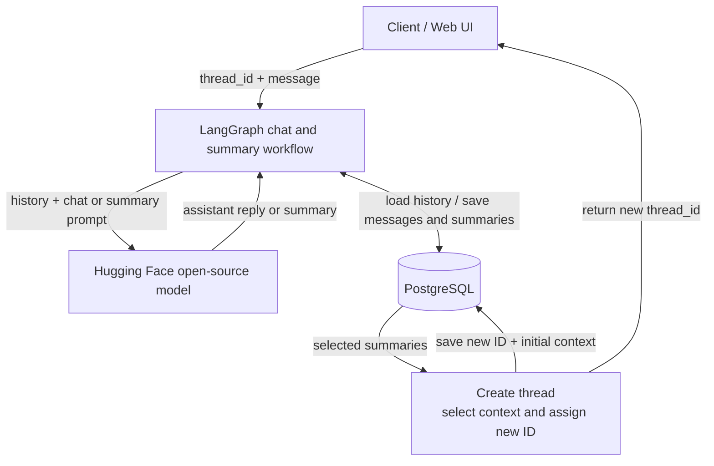

# Context Funnel System Diagram

## Flow

1. The client sends a message and a `thread_id` to the LangGraph workflow.
2. LangGraph loads that thread's history from PostgreSQL and calls the Hugging Face model.
3. For a summary request, the same model receives the source history with a summary prompt. LangGraph saves the returned summary in PostgreSQL.
4. The app selects useful saved summaries, applies the context budget, and creates a new thread with its own `thread_id` and initial context.
5. On the new thread's first message, LangGraph loads its seeded context and its separate message history by `thread_id`.

The MVP will create summaries on request. Automatic summarization at a token threshold is a planned improvement.
